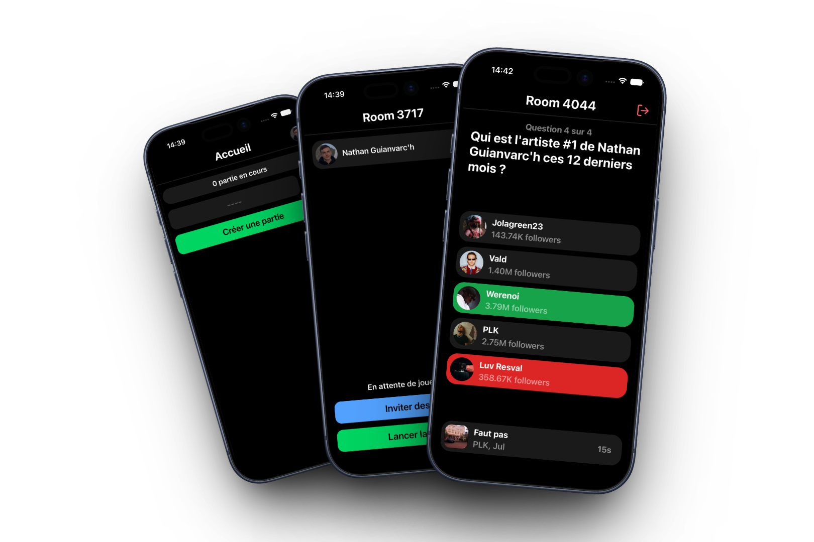

<h1 align="center">
  Questify
	
</h1>

**Un blindtest multijoueur en temps réel, entre amis.**

Questify est une application mobile de quiz musical. Un joueur crée un salon, choisit un thème (une playlist ou un album du catalogue Apple Music), partage le code, et tout le monde devine les morceaux à partir d'un extrait audio de 30 secondes. Plus on répond vite, plus on marque de points.

Aucun compte n'est nécessaire : il suffit de choisir un pseudo au premier lancement.

> **Historique.** La première version de Questify générait ses questions à partir des statistiques d'écoute Spotify des joueurs. Spotify interdit les quiz dans sa Developer Policy et a fermé son API (voir [Pourquoi Spotify a été abandonné](#pourquoi-spotify-a-été-abandonné)). Le projet a été repensé autour du catalogue Apple Music, dont les extraits de 30 s sont accessibles sans connexion utilisateur.

---

## Fonctionnalités

### Démarrage sans compte

- Écran d'**onboarding** : le joueur saisit un pseudo, conservé de façon chiffrée avec `expo-secure-store`
- Écran de profil : modification du pseudo, choix de la langue, réinitialisation des données locales
- Application disponible en **français et en anglais** (`i18next`). La langue de l'appareil est détectée au premier lancement, puis le choix manuel est mémorisé

### Salons multijoueur temps réel

- Création d'une partie générant un **code à 4 chiffres**
- Rejoindre une partie par saisie du code, ou depuis la liste des **parties publiques** de l'accueil
- Salon **privé ou public**, au choix de l'hôte
- Jusqu'à **5 joueurs** par salon
- Hôte identifié par une couronne ; transfert automatique du rôle si l'hôte part
- Expulsion d'un joueur par l'hôte
- Fermeture automatique du salon quand le dernier joueur part
- Sortie de partie avec confirmation, et gestion des déconnexions réseau
- **Rejouer** : l'hôte relance une partie dans le même salon depuis l'écran de résultats

### Réglages de la partie

Configurables par l'hôte depuis la page de réglages, synchronisés en direct chez tous les joueurs :

- **Thème musical** : sélecteur de playlists et d'albums Apple Music, avec recommandations (top playlists, top albums, charts par genre) et recherche. Sans choix, la playlist n°1 du moment est utilisée
- **Visibilité** : privé / public
- **Nombre de questions** : 5, 10 ou 15
- **Temps par question** : 10, 15 ou 20 secondes, ou sans limite

### Invitation et partage

- Génération d'un lien de partage passant par le serveur (`/share/:roomCode`)
- Page de redirection avec **métadonnées Open Graph** pour un aperçu propre sur WhatsApp, iMessage ou Discord
- Le lien ouvre l'application via le deep link `questify://room/:roomCode` et **fait rejoindre automatiquement le salon** (si aucun pseudo n'est défini, le joueur passe d'abord par l'onboarding)
- Partage depuis la feuille de partage native iOS/Android

### Génération des questions

- Une question = un extrait audio de 30 s, à qui il faut associer le bon titre : « Quelle est cette musique ? »
- 4 propositions par question : la bonne réponse et 3 morceaux de la même playlist ou du même album
- Seuls les titres qui disposent d'un extrait sont retenus, et le catalogue est dédoublonné avant la partie
- Les morceaux déjà posés et les mauvaises réponses déjà vues sont évités tant que le catalogue le permet
- Les questions sont intégralement pré-générées au lancement de la partie
- Si la source contient moins de 4 morceaux jouables, ou si le catalogue est injoignable, l'hôte est prévenu et la partie ne démarre pas

### Boucle de jeu

- Lecture de l'extrait à l'affichage de chaque question, avec **fondu enchaîné** entre deux extraits (`useCrossfadeAudioPlayer`)
- **Compte à rebours** sous forme d'anneau animé, synchronisé sur l'horloge du serveur (mesure du décalage par échantillonnage `timeSync`), pour que tous les joueurs voient la même échéance
- Réponses colorées selon leur état : en attente, sélectionnée, correcte, incorrecte, avec affichage des choix des autres joueurs à la révélation
- **Retour haptique** (`expo-haptics`) et **animations** (`react-native-reanimated`, `moti`)
- **Fin de question gérée côté serveur** : elle se déclenche quand tous les joueurs ont répondu, ou à l'expiration du temps, puis enchaîne sur la question suivante
- **Scoring basé sur la vitesse**, calculé côté serveur (le client ne connaît jamais la bonne réponse à l'avance) : 1000 points pour une réponse instantanée, jusqu'à 500 points pour une réponse à la dernière seconde, et 1000 points fixes si le temps est illimité
- Écran de résultats avec classement, avatars, scores et **confettis**

---

## Stack technique

| Partie      | Technologies                                                                                                                                                                     |
| ----------- | -------------------------------------------------------------------------------------------------------------------------------------------------------------------------------- |
| **Mobile**  | Expo 57, React Native 0.86, Expo Router (routage par fichiers), Zustand, NativeWind 4, react-native-reanimated 4, moti, expo-audio, expo-secure-store, i18next, socket.io-client |
| **Serveur** | Bun, Express 5, Socket.IO, proxy de l'API Apple Music (MusicKit)                                                                                                                 |
| **Partagé** | TypeScript : types de domaine et contrats d'événements Socket.IO typés de bout en bout                                                                                           |
| **Infra**   | Docker, Render (`render.yaml`), EAS Build pour les builds mobiles, GitHub Actions pour le typecheck                                                                              |

Le point le plus intéressant de l'architecture est le package `shared` : les interfaces `ServerToClientEvents` et `ClientToServerEvents` y sont déclarées une seule fois, puis consommées par le serveur **et** par le client. Toute divergence de contrat entre les deux côtés devient une erreur de compilation plutôt qu'un bug silencieux à l'exécution.

### Structure

```
questify/
├── mobile/                 # Application Expo / React Native
│   ├── app/                # Écrans (routage par fichiers)
│   │   ├── _layout.tsx     # Layout racine, restauration de la langue
│   │   ├── onboarding.tsx  # Choix du pseudo au premier lancement
│   │   ├── (tabs)/         # Onglets : accueil (créer / rejoindre) et profil
│   │   ├── room.tsx        # Salon (différent selon l'état de la partie)
│   │   ├── room/[roomCode].tsx  # Entrée par lien d'invitation
│   │   └── settings-room.tsx    # Réglages de la partie (hôte)
│   ├── screens/            # Les trois phases de jeu
│   │   ├── WaitingScreen.tsx
│   │   ├── GameInProgress.tsx
│   │   └── GameFinished.tsx
│   ├── components/         # Answer, TimerRing, Confetti, SelectPlaylistModal…
│   │   └── ui/             # Button, Input, SegmentedControl, TabBar
│   ├── hooks/              # Stores Zustand, socket, lobby, synchro d'horloge, audio
│   └── i18n/               # Configuration i18next et traductions fr / en
│
├── server/                 # API et serveur temps réel
│   └── src/
│       ├── index.ts        # Express, page de partage, point d'entrée
│       ├── socket.ts       # Initialisation Socket.IO
│       ├── sockets/        # Gestionnaires d'événements de salon et de jeu
│       ├── state/          # État en mémoire (salons, scores, réponses, timers)
│       ├── routes/         # Catalogue Apple Music (music, playlist, album)
│       └── utils/          # Génération des questions, client MusicKit
│
└── shared/                 # Types et contrats partagés
    └── src/types/          # Room, Player, GameQuestion, événements socket
```

Les recommandations et les recherches du sélecteur de thème sont mises en cache en mémoire côté serveur pour limiter les appels à Apple. L'état des parties est lui aussi conservé en mémoire.

### API du serveur

| Route                        | Rôle                                                      |
| ---------------------------- | --------------------------------------------------------- |
| `GET /music/recommendations` | Sections de playlists et d'albums (top, charts par genre) |
| `GET /music/search`          | Recherche de playlists et d'albums                        |
| `GET /playlist/most-played`  | Playlists les plus écoutées                               |
| `GET /album/most-played`     | Albums les plus écoutés                                   |
| `GET /share/:roomCode`       | Page de partage avec métadonnées Open Graph               |

---

## Installation

### Prérequis

- [Bun](https://bun.sh)
- Xcode (iOS) et/ou Android Studio
- Un **developer token MusicKit** (JWT) généré depuis un compte Apple Developer, pour interroger le catalogue Apple Music

### Variables d'environnement

`server/.env`

```
MUSICKIT_DEVELOPER_TOKEN=...
PORT=3000
```

`mobile/.env`

```
EXPO_PUBLIC_SERVER_URL=http://localhost:3000
```

### Lancement

```bash
bun install
bun run dev          # mobile + serveur en parallèle
```

Ou séparément :

```bash
bun run server       # API sur le port 3000
bun run mobile       # bundler Expo (dev client)
```

### Build natif

L'application utilise des modules natifs (audio, stockage sécurisé) : Expo Go ne suffit pas, il faut un build de développement.

```bash
cd mobile
bun run prebuild:ios   # génère le projet iOS et installe les pods
bun run ios:dev        # build de développement sur appareil
bun run android:dev
```

Les builds de production passent par EAS (`mobile/eas.json`).

### Vérifications

```bash
bun run typecheck    # shared, server et mobile
```

Le même contrôle tourne en CI à chaque push et pull request (`.github/workflows/typecheck.yml`).

### Déploiement du serveur

Le serveur est conteneurisé (`server/Dockerfile`) et déployable sur Render via `render.yaml`. La variable `MUSICKIT_DEVELOPER_TOKEN` doit y être renseignée.

---

## Pourquoi Spotify a été abandonné

La première version de Questify s'appuyait sur Spotify : connexion OAuth, questions du type « Qui est l'artiste n°1 de Nathan ces 12 derniers mois ? » construites à partir des statistiques d'écoute des joueurs, et extraits audio de 30 s. Entre novembre 2024 et février 2026, cette approche est devenue impossible à publier.

- **Les quiz sont explicitement interdits.** La Developer Policy de Spotify interdit « Incorporating Spotify into any gaming or quiz functionality. For example, a "name that tune" quiz would not be allowed. » L'interdiction couvre toute donnée Spotify utilisée dans un jeu, quelle que soit l'implémentation
- **L'accès étendu est fermé aux développeurs individuels.** Depuis mai 2025, l'_Extended Quota Mode_ est réservé aux entreprises déjà établies (de l'ordre de 250 000 utilisateurs actifs mensuels). Une application indépendante reste donc bloquée en _Development Mode_
- **Les endpoints nécessaires ont disparu.** `preview_url` (les extraits de 30 s) a été retiré en novembre 2024 pour les nouvelles applications. En février 2026, le mode développement est limité à 5 utilisateurs avec abonnement Premium obligatoire, et des endpoints comme artist top-tracks ont été supprimés

Le catalogue Apple Music, lui, expose des extraits de 30 s sur ses titres sans connexion utilisateur, ce qui supprime le besoin de compte et de statistiques personnelles. En contrepartie, les questions ne portent plus sur les goûts des joueurs mais sur un thème choisi (playlist ou album).

Toute l'intégration Spotify a été retirée du code.

---

Projet personnel, publié à titre de démonstration technique.
